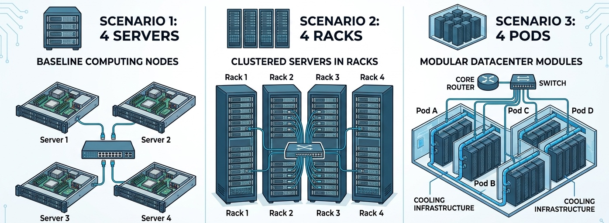

# Hands-on session  

Jump to [Activity 1](#activity-1-dfvs-in-servers)

Jump to [Activity 2](#activity-2)

## Activity 1. DFVS in servers

Open the [dashboard](https://paolo-giaccone.github.io/edu-visuals/datacenter-energy/cmos_energy_tradeoff.html) and check the following settings (they should be the default ones)
- Task workload $N = 5 \times 10^9$ cycles
- Threshold voltage $V_{th}=0.35~V$
- Leakage current $I_{leak}=0.45~A$

Now move the slides of the supply voltage to verify that the data in the following table is correct.

 | Scenario | Supply voltage $V$ | Clock Frequency $f$ | Execution time | Task energy |
 | :---: | :---: | :---: | :---: | :---: |
 | S1 | 1.00 V | 2.20 GHz | 2.27 s | 7.2 J |
 | S2 | 1.00 V | 2.60 GHz | *unfeasible* | — |
 | S3 | 0.75 V | 2.20 GHz | *unfeasible* | — |

**Q1:** Why scenario S2 is unfeasible?

**Q2:** Why scenario S3 is unfeasible?

**Q3:** Consider scenario S1 and modify *only* **clock frequency** to obtain an execution time equal to 5.0 s. Let S4 be the new scenario. Fill the following:

 | Scenario | Supply voltage $V$ | Clock Frequency $f$ | Execution time | Task energy |
 | :---: | :---: | :---: | :---: | :---: |
 | S4 | 1.0 V | ... GHz | 5.0 s | ... J |

<!---  1 GHz, 8.25 J --->

Did you experience a reduction in task energy? Why?

<!---  No, due to the static power --->

**Q4:** Consider scenario S4 and modify *only* **supply voltage** to reduce as much as possible the task energy. Let S5 be the new scenario. Fill the following:

 | Scenario | Supply voltage $V$ | Clock Frequency $f$ | Execution time | Task energy |
 | :---: | :---: | :---: | :---: | :---: |
 | S5 | ... V | ... GHz | 5.0 s | ... J |

Did you experience a reduction in task energy with respect to S3 and S4? Why?
<!--- 
0.58V, 1 GHz, 3.32J
reduced with respect to S4 (40%)
reduced with respect to S1 (46%)
--->

**Q5:** Consider scenario S1 and modify *only* the **clock frequency** to minimize the overall task energy.
Let S6 be the new scenario. Fill the following:

| Scenario | Supply voltage $V$ | Clock Frequency $f$ | Execution time | Task energy |
 | :---: | :---: | :---: | :---: | :---: |
 | S6 | 1.00 V | ... GHz | ... s | ... J |
<!---  2.35GHz, 2.13s, 6.96J
 This almost the same as S1 --->

**Q6 (Min execution time policy):**  Consider scenario S1 and modify *only* the **clock frequency** and the **supply voltage** to minimize the task execution time.
Let S7 be the new scenario. Fill the following:

| Scenario | Supply voltage $V$ | Clock Frequency $f$ | Execution time | Task energy |
| :---: | :---: | :---: | :---: | :---: |
| S7 | ... V | ... GHz | ... s | ... J |

Compare the execution time and the task energy with respect to S1.
<!---  3.25GHz, 1.54s, 13.62J --->

**Q7 (Min energy policy):** Consider scenario S1 and modify *only* the **clock frequency** and the **supply voltage** to minimize the task execution time across . (Hint: Use voltage around 0.4-0.5 V)

Let S8 be the new scenario. Fill the following:

| Scenario | Supply voltage $V$ | Clock Frequency $f$ | Execution time | Task energy |
| :---: | :---: | :---: | :---: | :---: |
| S8 | ... V | ... GHz | ... s | ... J |

<!---  0.48V, 0.45 GHz, 11s, 3.78J --->

**Q8:** Summarize the results in the following table:

| Scenario | Supply voltage $V$ | Clock Frequency $f$ | Execution time | Task energy |
| :--- | :---: | :---: | :---: | :---: |
| S7 (Min execution time policy)| ... V | ... GHz | ... s | ... J |
| S8 (Min energy policy) | ... V | ... GHz | ... s | ... J |

Compare the different energy vs execution time tradeoff.

## Activity 2.

We evaluate a scenario with 4 servers. This model easily generalizes to a full data center setting where each server represents an entire rack or pod, simply by applying an appropriate scaling factor (e.g., $10^3$ for a server rack).

Open the [dashboard](https://paolo-giaccone.github.io/edu-visuals/datacenter-energy/datacenter_power_onoff.html) and check the following settings (they should default)
- Total workload capacity 180%
- Perfect load balancing
- Server: Idle Power $P_{idle}$=100 W,  Max power $P_{max}$=300 W

| Scenario | Server 1-4 Allocation % | Power (linear profile) | Power (onoff profile)| Power (cubic profile) |
| :--: | :--: |  :--: |  :--: | :--:|  
| S1 | 45,45,45,45 | 760 W | 1200 W | 473W |

The number of the active servers are 4.

Observe:
-  the graphs of the *POD Load Distribution* and of the *Total Datacenter Power* are redundant with the other data reported in the dashboard;
- the final graph reports the three power profiles and shows the operating points of the four server (reported, for the sake of simplicity, just on the cubic curve);
- when modifying the server workload allocation, check that the "Total Datacenter Power" is the expected value;
- by construction, it is not possible to perform a direct comparison between the results obtained with different power profile models.

**Q1:**
Consider an **OnOff power profile**. 
Find the power consumption for different workload. 
| Workload Capacity Load | Power [W] for Consolidate | Power [W] for Consolidate with Load Balance | Power [W] for Load Balance |
| :---: | :---: | :---: | :---: |  
| 80%   |       |       |       |
| 160% |  |  | |   
| 240% |  |  | |
| 320% | | ||
| 400% |||  | 
<!---
| 80%   |  300  | 300   |   1200|
| 160% |  600   | 600   |   1200|   
| 240% | 900    | 900   |   1200|
| 320% | 1200   | 1200  |   1200|
| 360% | 1200   | 1200  |   1200|
| 400% | 1200   | 1200  |   1200| 
--->

**Q2:**
What is the best policy for OnOff power profile? 
Is it the same for all possible workloads?
<!--
Consolidate and Consolidate with Load Balancing are always the best and perform the same. 
-->

**Q3:**
Consider a **Linear power profile**. 
Find the power consumption for different workload. 
| Workload Capacity Load | Consolidate | Consolidate with Load Balance | Load Balance |
| :---: | :---: | :---: | :---: |  
| 80%   ||||
| 160%  ||||   
| 240%  ||||
| 320%  ||||
| 400%  ||||
<!---
| 80%   |260    | 260   | 560   |
| 160%  |520    | 520   | 720   |   
| 240%  |780    | 780   | 880   |
| 320%  |1040   | 1040  | 1040  |
| 400%  |1200   | 1200  | 1200  | 
--->

**Q4:**
What is the best policy for linear power profile?  Is it the same for all possible workloads?
<!--- Consolidate with or without load balancing is always the best, but when the maximum number of server is achieved, no difference with basic Load balance.
--->

**Q5:**
Consider a **Cubic power profile**. 
Find the power consumption for different workload. 
| Workload Capacity Load | Consolidate | Consolidate with Load Balance | Load Balance |
| :---: | :---: | :---: | :---: | 
| 80%   ||||
| 160%  ||||   
| 240%  ||||
| 320%  ||||
| 400%  ||||
<!--- 
| 80%   | 202 | 202 | 405 |
| 160%  | 443 | 405 | 451|   
| 240%  | 713 | 607 | 573 |
| 320%  | 1002| 810 | 810 |
| 400%  | 1200|1200 | 1200| 
--->

**Q6:**
What is the best policy for cubic power profile? Is it the same for all possible workloads?
<!-- Consolidate with Load Balance is the best choice for low and high load. Load Balance is the best for medium load and it is the same as Consolidate with Load Balance with high low
-->

**Q7:**
Comparing the results obtained with different power profiles, is it possible to identify the best policies in general?
<!--
Consolidate with Load Balance is the best choice due to Pidle. Load Balance is the optimal only in some scenarios, due to Pidle.
-->

